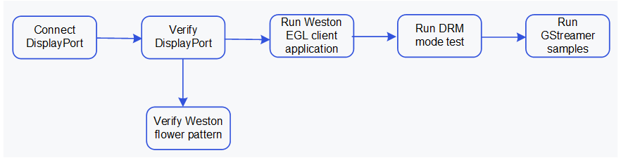
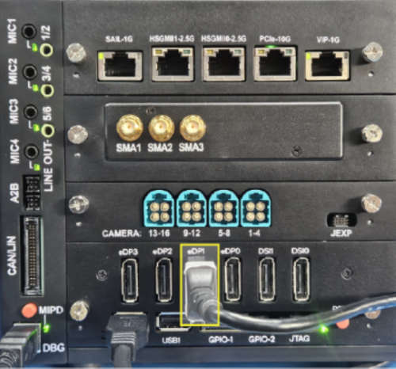

.. _connect_displayport_display_for_qcs9100:

Getting started with IQ-9075
============================

.. centered:: **Figure : DisplayPort setup workflow**

Before you begin, set up your infrastructure as described in the `Qualcomm Linux Build
Guide <https://docs.qualcomm.com/bundle/publicresource/topics/80-70017-254/introduction.html>`__.

.. _section_z5p_ygt_lcc:

Connect DisplayPort
-------------------

The display subsystem provides the Weston and Wayland compositors, and
``libdrm`` that interact with the DPU driver to render the Wayland
client applications. The sample test applications evaluate
the basic rendering of the Wayland applications and connect the
DisplayPort. 
Connect the DisplayPort cable to eDP0 connector as shown in
the following figure:

.. centered:: **Figure : DisplayPort setup**

**Verify the DisplayPort setup**

To verify the DisplayPort setup, power ON the device. Weston
starts automatically when the device boots up. You should see the
following Weston flower pattern on the display monitor:

.. centered:: **Figure : Weston flower pattern**

For more information, see the following sections:

-  :ref:`Weston EGL client application <section_sdr_f2f_q1c_mneogi_03-04-24-1631-55-820>`
-  :ref:`GStreamer samples <section_irf_5ng_lcc>`

.. _section_wxm_rf1_mcc:

DRM modetest
-------------

The DRM modetest checks if the display driver topology is working as
expected. The test ensures that the DSI and the DPU paths are working
effectively. 
To run the modetest, do the following:

1. To kill the Weston client application, run the following commands in
   the device shell:

   .. note:: 
      You must enable SSH in Permissive mode to securely access your host device.
      For instructions, see `How to SSH <https://docs.qualcomm.com/bundle/publicresource/topics/80-70017-254/how_to.html#how-to-ssh->`__.

   ::

      mount -o remount,rw /

   ::

      ps -A | grep weston

   **Sample output:**

   ::

       824 ?        00:00:12 weston
         1090 ?        00:00:00 weston-keyboard
         1092 ?        00:00:01 weston-desktop-

   The Weston process ID from the sample Weston process list is used to
   kill the Weston processes.

2. To kill all the Weston processes, run the following command:

   ::

      killall weston

3. To change the permissions of the modetest application, run the
   following command:

   ::

      chmod 0777 /usr/bin/modetest

4. To know the connector ID and modes, run the following command:

   ::

      /usr/bin/modetest -c msm_drm > /opt/drm_mode.txt

5. To check for the DRM modes and connector information, pull the
   ``/opt/drm_mode.txt`` file locally on your host machine. Use the
   secure copy protocol (SCP) tool to pull the ``drm_mode.txt`` file
   from the device to your host machine. For example,

   ::

      scp -r root@<IP of the device>:/opt/drm_mode.txt <directory path of the host machine>

   .. note:: When prompted for a password, enter ``oelinux123``.

   The output as shown in the following figure is from the
   ``/opt/drm_mode.txt`` file.

   .. image:: ../../media/qli-display/Command_prompt_output.png
      :align: center
   .. centered:: **Figure : Command prompt output**

6. Use the relevant values from the ``/opt/drm_mode.txt`` file to fetch
   the connector ID and mode name:

   ::

      modetest -c msm_drm -s <Connector id>:<mode name>

7. To launch the modetest application, run the following sample command
   using the connector ID and mode name that you retrieved from the
   ``/opt/drm_mode.txt`` file, for example:

   ::

      /usr/bin/modetest -c msm_drm -s 32:1920x1080-60

   .. note:: On launching the DRM test application, ignore the warning log: ``Failed to set gamma: Function not implemented``

.. centered:: **Figure : DRM modetest sample application output screen**

.. note:: 
   To relaunch the Weston server, see :ref:`Relaunch Weston <section_mr4_fkl_xbc>`.

