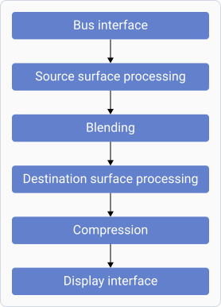

.. _detailed_software_architecture:

Display hardware architecture
===============================

The hardware architecture includes components for source and destination
processing, layer mixing, compression, and display interfaces.

.. centered:: **Figure: DPU hardware architecture block diagram**

The following table lists the components of the display hardware architecture.

.. table:: Table: Display hardware architecture components

   .. list-table:: 
      :header-rows: 1
      :class: longtable table-wrap
      :align: center
 

      - 

         - **Component**
         - **Description**
      - 

         - Bus interface
         - Fetches data from memory for processing
      - 

         - Source surface processing
         - 

           | Reads RGB and YUV surfaces from games and video applications
           | Performs format conversion and quality improvements for the source
      - 

         - Blending
         - Blends and mixes the source surface together
      - 

         - Destination surface processing
         - Converts, corrects, and adjusts the data based on panel characteristics
      - 

         - Compression
         - Reduces bandwidth and power consumption by sending compressed display buffers to the display
      - 

         - Display interface
         - Generates timings for the connected display peripherals

Detailed information on the display hardware architecture is available
to licensed developers with authorized access. For more information, see `Qualcomm Linux Display
Guide -
Addendum <https://docs.qualcomm.com/bundle/resource/topics/80-70033-18A/architecture.html#high-level-display-hardware-architecture>`__.

