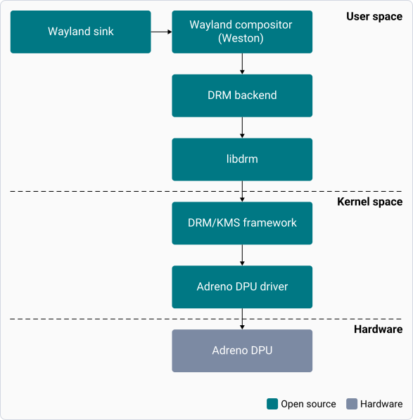

.. rst_class:: flattenforhtml

.. _high_level_overview_of_the_display_architecture_0:

Display software architecture
===============================

The display subsystem consists of Wayland, a display server protocol,
and its compositors, such as Weston. Wayland uses a client-server model where the client application interacts with the Wayland server.

.. centered:: **Figure: Display software architecture block diagram**

The components of the display software architecture are as follows:

   .. tabularcolumns:: |p{3cm}|p{9cm}|
   .. list-table:: Table: Display software architecture components
      :header-rows: 1
      :class: longtable table-wrap
      :align: center
 

      - 

         - **Component**
         - **Description**
      - 

         - Wayland sink
         - The Wayland sink plug-in communicates with the Weston subsystem to render the display.
      - 

         - Wayland compositor (Weston)
         - The Wayland compositor uses the Wayland protocol as a display server. The compositor handles the composition and rendering requirements at the system level and runs as a separate process in the system. Weston serves as the reference implementation of a Wayland compositor.

      - 
         -  Direct rendering manager (DRM) backend
         -  The DRM backend software framework manages the Qualcomm Adreno DPU hardware resources. It selects the optimal composition strategy for each connected display and allocates display processor hardware resources for the layer stack received from the client.
      - 

         - ``libdrm``
         -  The ``libdrm`` library provides APIs for accessing the DRM I/O control (IOCTL).
      - 

         - DRM/KMS framework
         -  The DRM/KMS framework offers kernel and userland level interface, with the help of ``libdrm`` libraries to access the related hardware features, configuration, and hardware acceleration.
      - 

         - Adreno DPU driver
         - The Adreno DPU driver manages all the pixel data paths to different panel interfaces.
      - 

         - Adreno DPU
         - The Adreno DPU is a hardware-accelerated engine that performs image processing and interfacing with minimal power consumption.

Software APIs
^^^^^^^^^^^^^^^

   Qualcomm Linux provides the following display APIs:

   - Weston API: facilitates interactions with the DRM compositor. For the Weston APIs, see `Wayland client APIs <https://wayland.freedesktop.org/docs/html/apb.html>`__ and `Wayland server APIs <https://wayland.freedesktop.org/docs/html/apc.html>`__.
   - ``libdrm`` API: facilitates interactions with the DRM/KMS framework. For the APIs, see `libdrm <https://dri.freedesktop.org/docs/drm/gpu/drm-uapi.html>`__.

   Qualcomm provides you the GStreamer-based plugins. You can add the Waylandsink plugin to your media pipeline from `IM SDK plugins <https://docs.qualcomm.com/bundle/publicresource/topics/80-70033-50/qim-sdk-plugins.html>`__.

   For more information, see `GStreamer application development and pipeline creation <https://gstreamer.freedesktop.org/documentation/application-development/basics/index.html>`__.

   