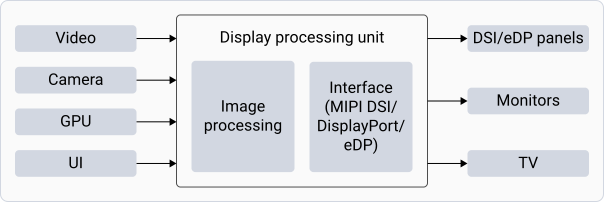

.. rst_class:: flattenforhtml
   
.. _Overview:

Display overview
################

The Qualcomm\ :sup:`®` Adreno™ Display Processing Unit (DPU) provides hardware-accelerated
image processing. The DPU retrieves pixel data from the memory and sends
it to the display peripherals through standard interfaces.

.. centered:: **Figure: DPU architecture**

The DPU provides the following image processing and interface
capabilities:

-  **Image processing** includes the following:

   -  **Composition**: blends individual layers into a single frame and sends it to the display panel
   -  **Scaling**: supports upscale and downscale of the source image to
      match the panel resolution
   -  **Color format conversion**: converts colors from one color format
      to another (from YUV to RGB)
   -  **Color space conversion**: converts colors from one color space
      to another (sRGB, P3, and BT2020)
   -  **Color processing**: enhances the colors for better visual
      quality

-  **Interfaces**: Connects with various panels using mobile industry
   processor interface display serial interface (MIPI DSI) and TV or
   Monitor with the DisplayPort interface

   -  **MIPI DSI**: defines the protocols between a host processor and
      peripheral devices that adhere to the MIPI alliance specifications
      for mobile device interfaces
   -  **DisplayPort**: serves as a digital display interface, primarily
      connecting video sources to display devices such as computer
      monitors, and can also transmit audio, USB, and other data forms

The |80-70033-50_link|_ and the ``libdrm`` APIs expose the hardware capabilities of the Adreno DPU engines.

.. note:: 
   See `Hardware SoCs <https://docs.qualcomm.com/bundle/publicresource/topics/80-70033-115/soc.html>`__ that are supported on Qualcomm\ :sup:`®` Linux\ :sup:`®`.
   
.. _80-70033-50_link: https://docs.qualcomm.com/bundle/publicresource/topics/80-70033-50/overview.html
 
.. |80-70033-50_link| replace:: Qualcomm\ :sup:`®` Intelligent Multimedia SDK (IM SDK)

.. include:: architecture.rst

